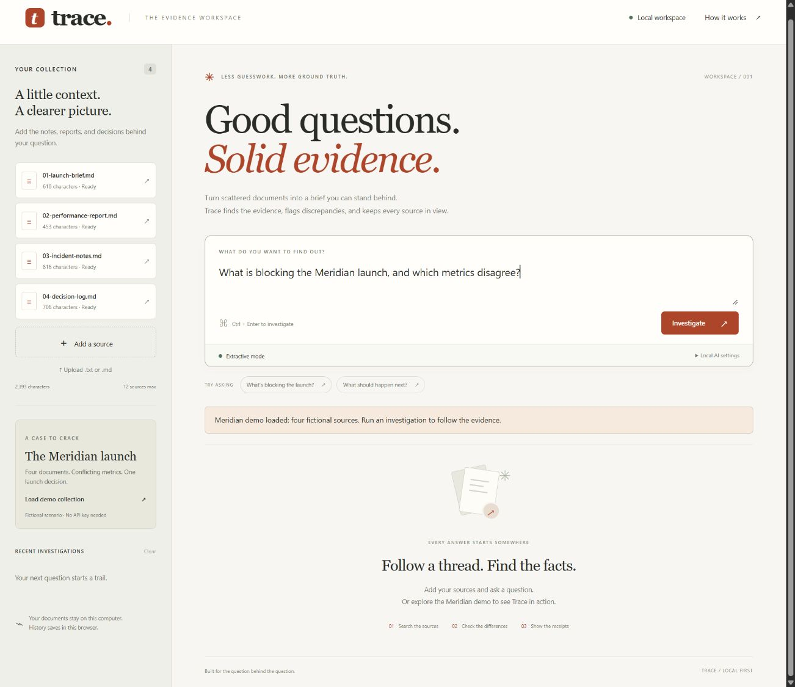
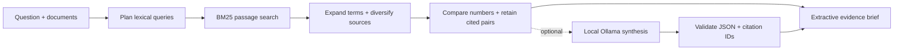

# Trace

### Good questions. Solid evidence.

An inspectable, local evidence investigation agent. Give it scattered reports and a
question; get exact quotations, source links, numerical discrepancies, and a clear
execution trail. Optional Ollama synthesis adds a local language model.

**Start in one command. No API key. No package installation.**



## Run it

Requires **Python 3.11+** and a modern browser. From this repository's root:

```sh
python -m trace.server
```

Open **http://127.0.0.1:8765**. On systems where Python is named `python3`, use that
command instead. For another port: `python -m trace.server --port 8888`.
Stop the server with Ctrl+C. The service listens only on loopback.

1. Click **Load demo collection**.
2. Click **Investigate** (or Ctrl/Cmd+Enter).
3. Compare **420 ms vs 870 ms**, then click either value to see the exact source.
4. Filter findings by source, inspect the agent's trail, and **Export brief**.

The Meridian launch case is fictional. Its measurement differences have a reason:
the tests used different cache and retry conditions. Trace flags the discrepancy
for review rather than claiming that one report is false.

You can also paste documents or upload UTF-8 `.txt`/`.md` files. Up to 12 sources,
100,000 characters per source, and 300,000 characters per collection. Active sources
stay in memory. The last eight investigations save source snapshots in this
browser's local storage; **Clear** removes saved history.

## What the agent actually does



- **Plan:** tokenize the question and choose bounded query expansions.
- **Search:** rank sentence passages with BM25; document headings are excluded.
- **Cross-check:** search expanded terms and retain source diversity. Comparison
  questions trigger a numerical scan of retrieved sources, with paired quotations
  reserved within the ten-passage evidence budget.
- **Verify:** stable citations identify the document content and character offset;
  each quote can be reconstructed from the source. Compare explicit statements
  such as “checkout latency is 420 ms” across different documents.
- **Compose:** show the quotations, discrepancies, execution log, and follow-ups.
  No matching evidence produces an explicit insufficient-evidence result.

The default workflow is deterministic and **extractive**, not a simulated LLM.
Its planning and tool orchestration are code-defined. It does not autonomously
select arbitrary tools, browse the web, or execute document instructions.

## Optional local AI

If Ollama is already installed and you have a local model, expand **Local AI
settings** and enter its name, for example `qwen3:4b` if that model is available on
your machine. Trace never downloads models or falls back to a cloud provider.

The adapter calls the [official Ollama generate API](https://docs.ollama.com/api/generate)
at `http://127.0.0.1:11434/api/generate`, using JSON output and non-streaming
responses. It sends only the question and retrieved evidence. Ambient HTTP proxies
and redirects are disabled. The local request times out after 45 seconds.

Model output must contain a nonempty summary and known citation IDs. Invalid
output, missing models, or connection errors produce a visible extractive fallback.
Synthesis is clearly labeled: **a valid citation ID does not prove a generated
claim is supported**. Always inspect the quotations. A model can still be wrong or
follow malicious source text despite the system instruction.

No live downloaded model was used during development verification. The adapter's
HTTP contract, successful response handling, and failure behavior were tested with
a real loopback test server. See [verification evidence](docs/TESTING.md).

## Test it

Python and Node.js 18+ are sufficient; there are no pip or npm dependencies.

```sh
python -m unittest discover -s tests -v
node --test tests/client.test.mjs
python -m compileall -q trace tests
node --check web/app.js
git diff --check
```

On Windows, the same checks are collected in:

```powershell
.\.codex\scripts\check.ps1
```

**64 Python tests + 8 JavaScript tests** cover retrieval, source provenance,
abstention, a small gold-source evaluation set, Unicode and size boundaries,
model response validation, redirects, HTTP origins/hosts, traversal, concurrency,
history corruption, and Markdown export. Browser acceptance checks additionally
cover uploads, filters, dialogs, cancellation, history, and responsive layouts.

CI runs the dependency-free checks on Windows and Linux with Python 3.11 and 3.13.
Browser acceptance is documented separately; it is not included in that CI matrix.

## Engineering choices and limits

| Choice | Benefit | Trade-off |
|---|---|---|
| Standard-library Python + native browser modules | One-command startup; no dependency bootstrap | Small, local app; not a production web service |
| BM25 + bounded expansion | Fast, inspectable retrieval | Can miss paraphrases and match irrelevant passages |
| Exact sentence quotations | Reviewable provenance | Extracts may need surrounding context |
| Narrow numerical comparison | Explainable review flags | No unit conversion, temporal reasoning, tables, or semantic contradiction detection |
| Optional local LLM | Private synthesis without a cloud key | Requires an existing model; generation quality varies |
| Browser-local snapshots | Reopen a brief with its original sources | Sensitive text persists in this browser until cleared |

The app deliberately has no PDF parsing, web crawling, accounts, database, telemetry,
or deployment configuration. Do not expose this local server to the Internet.
Cancellation stops the browser request; an already-started local model call may
continue until it completes or reaches its timeout.

## Read the code

```text
trace/engine.py          Bounded investigation, BM25, citations, comparisons
trace/model.py           Optional local model HTTP adapter
trace/server.py          Local HTTP service, validation and static allowlist
trace/demo.py            Four fictional source documents
web/                    Responsive, accessible native browser client
tests/                  Python and JavaScript regression suites
docs/                   Design, write-up, verification, sample brief, screenshots
```

[Project write-up](docs/WRITEUP.md) · [Design](docs/DESIGN.md) ·
[Sample exported brief](docs/example-brief.md) · [Verification](docs/TESTING.md)

Built with AI coding assistance. This repository records the implementation,
tests, design decisions, and limitations so the work can be inspected and extended.

MIT License · Matt Watson
